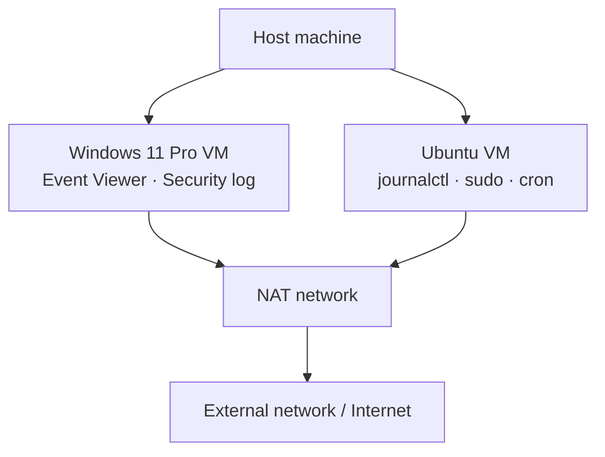
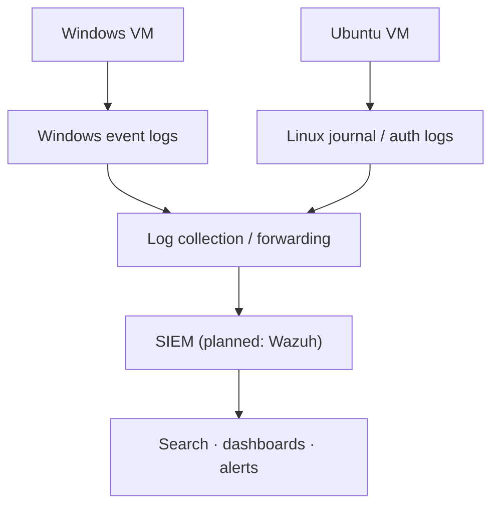

# SOC Home Lab Architecture

## Overview

The lab contains two virtual machines used to practice local log generation and manual event analysis: a Windows 11 Pro guest and an Ubuntu guest. The current workflow does not use a central log collector or SIEM.

## Current Architecture

NAT networking generally permits outbound connections while preventing unsolicited inbound access by default. This does not guarantee complete isolation: exposure depends on NAT configuration, port forwarding, host security, and firewall rules. The lab notes record NAT mode; the absence of port-forwarding rules should be verified in the virtualization settings.

## Planned Architecture

The centralized collection flow is a future improvement and is not implemented in the current phase.

## Virtual Machine Inventory

| Property | Windows VM | Linux VM |
|---|---|---|
| Operating system | Windows 11 Pro | Ubuntu (release not recorded) |
| RAM | Not recorded in the supplied notes | Not recorded in the supplied notes |
| Disk allocation | Not recorded in the supplied notes | Not recorded in the supplied notes |
| Network mode | NAT | NAT |
| Primary log source | Event Viewer → Windows Logs → Security | `journalctl`; service and `sudo` messages |
| Events examined | 4625 (failed logon), 4624 (successful logon) | `sudo` authentication/command record; `cron` service restart |

Add exact RAM, disk, Ubuntu release, and VMware product/version only after checking the actual VM settings. Do not leave guessed values in the final documentation.

## Log Collection Workflow

### Current state: local manual analysis

- **Windows:** User action → Windows Event Log → Event Viewer → manual review.
- **Linux:** User action → systemd journal → `journalctl` → manual review.

### Planned state: centralized analysis

Windows/Linux event sources → log forwarding → SIEM → searches, dashboards, and alerts.

## Security Controls Observed or Recorded

| Area | Control or capability | Status in this project |
|---|---|---|
| Network | NAT networking for both guests | Recorded in lab notes; confirm port-forwarding settings before publication |
| Windows logging | Security events available in Event Viewer | Demonstrated by the collected 4625 and 4624 records |
| Linux logging | systemd journal accessible with `journalctl` | Demonstrated by the `sudo` and `cron` records |
| Monitoring | Manual review and written event analysis | Implemented in the current phase |
| Centralized logging | SIEM/log forwarding | Planned, not implemented |
| Automated detection | Detection rules and alerting | Planned, not implemented |

Firewall state, automatic-update status, strong-password policy, encryption at rest, and backup configuration were not evidenced in the supplied event outputs. They should not be represented as verified controls until checked separately.

## Analysis Use Cases

1. **Authentication review:** Examine failed and successful Windows logon events and their sequence.
2. **Privileged command review:** Identify a `sudo` invocation, the account context, terminal, working directory, and command.
3. **Service-change review:** Identify service stop/start messages and determine what additional records are needed to attribute the action.
4. **Evidence correlation:** Compare records from different sources and distinguish confirmed facts from hypotheses.

## Time and Synchronization

The supplied notes use local timestamps. The Windows records include full date and time; the Linux examples were originally shown in the shorter `Oct 17 HH:MM:SS` format. Confirm the guest time zone and NTP synchronization status using the actual system settings before claiming that clocks are synchronized. For reliable cross-system correlation, record the timezone or normalize collected timestamps to UTC during analysis.

**Last updated:** 2026-10-17

